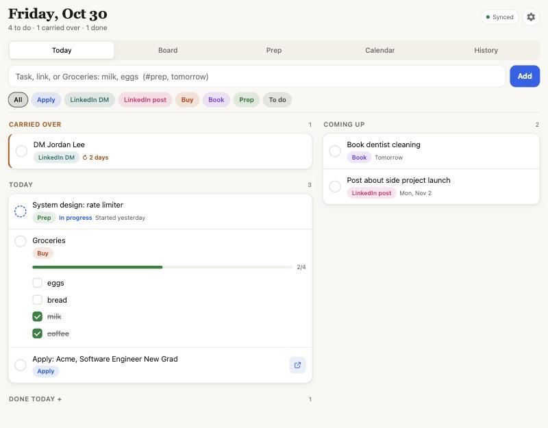
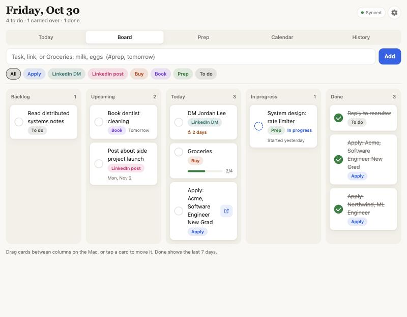
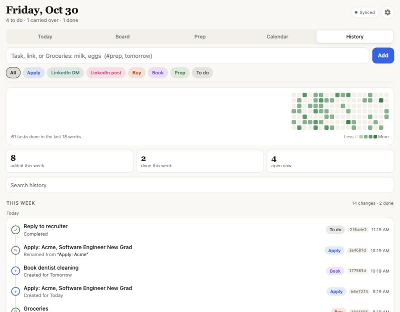

# Today Board

A personal daily task board for iPhone and Mac. Installable web app (PWA), works offline, syncs through a free Cloudflare Worker + D1. Every change is kept in a git-style history, so nothing ever really disappears.

Runs entirely on Cloudflare's free tier: no servers, no cron jobs, no push notifications. It just shows you the right list when you open it.

| Today | Board | History |
| --- | --- | --- |
|  |  |  |

<sub>Screenshots use demo data.</sub>

## Why I built this

My tasks were everywhere. Job applications sat in Apple Notes, people I meant to message on LinkedIn were in a doc, groceries and errands were in Reminders, and prep topics were in yet another list. Every morning I had to check four places just to figure out what I was supposed to do, and the things I didn't finish yesterday quietly disappeared instead of following me into today. It got overwhelming, and the small stuff kept slipping.

None of those apps did what I actually needed, so I built one that does:

- **One place, opened once a day.** I open it and it shows today: what carried over, what's due, my calendar, and what's coming up this week. No hunting across apps.
- **Unfinished work follows me.** Anything I didn't get to rolls into today with a "carried N days" badge, so I can see what I keep putting off instead of losing it.
- **Adding a task takes seconds.** I paste a job link and it becomes `Apply: <Company>` with the real role title. A LinkedIn profile becomes `DM <Name>`. `Groceries: milk, eggs, bread` becomes a checklist. `#prep tomorrow` sets the tag and the day.
- **Same list on my iPhone and Mac.** Installed as an app on both, works offline, and syncs when I'm back online.
- **A record of what I actually got done.** The History tab keeps every change like a git log, so I can look back at a week of applications, DMs and prep and see the progress, not just the to-do list.
- **Free to run.** It lives on Cloudflare's free tier, with no subscription and no server to look after.

### A typical day

1. Open the app in the morning: two carried-over applications, a recruiter reply, groceries, and a 2 PM meeting from Outlook.
2. Paste three job links from LinkedIn during the day; each one turns into an Apply task with the company and role filled in.
3. Tick off items as I go, start a system design topic and mark it In progress.
4. Anything left rolls into tomorrow automatically. On Sunday, History shows how many applications and DMs went out that week.

## Features

- **Today screen** on every open: carried-over tasks, today's tasks, today's Outlook events, the next 7 days.
- **Daily rollover**: anything unfinished moves into today with a "carried N days" badge.
- **Tags**: Apply, LinkedIn DM, LinkedIn post, Buy, Book, To do, plus your own.
- **Paste a link** and it tags itself: Greenhouse, Lever, Ashby, Workday and other job boards become `Apply: <Company>`, LinkedIn profiles become `DM <Name>`, shops become Buy, booking sites become Book.
- **Job lookup**: pasting an Apply link fetches the real posting title and location (Lever, Ashby, Greenhouse, Workday, SmartRecruiters APIs, else the page title) and warns if the posting looks closed.
- **Quick add**: `Coffee chat prep #todo tomorrow`, `#buy charger fri`, `dentist #book backlog`.
- **Board**: Backlog, Upcoming, Today, In progress, Done (drag on Mac, tap to move on iPhone).
- **Calendars** (read only): Outlook and Apple Calendar through published ICS links, merged and labeled by source, with recurring meetings, time zones and moved instances handled. Any event can become a task.
- **Checklists**: `Groceries: milk, eggs, bread` creates one task with a checklist (auto-tagged Buy).
- **Prep tab**: everything In progress with when you started it, plus `#prep` tasks not started yet. In-progress work rolls forward without counting as a slip.
- **History tab**: a git-style log of every change (created, started, moved, renamed, retagged, checklist progress, completed, deleted), grouped by week, with a short hash per change, search, tag filter, a contribution heatmap of finished tasks, and weekly stats. Tap any change to see that task's whole log, like `git log -- file`.
- **Not-syncing banner**: a copy of the app with tasks but no token says so loudly.

## Layout

```
public/        the app (HTML, CSS, JS, service worker, icons)
src/worker.js  API: /api/sync, /api/history, /api/settings, /api/calendar, /api/lookup (Bearer token auth)
src/ics.js     iCalendar parser and recurrence expansion
src/lookup.js  job link -> company, title, location via public job board APIs
schema.sql     D1 tables (tasks, task_events change log, settings)
migrations/    one-time backfill of history for boards created before the change log
```

## Deploy (one time)

```bash
npm install
npx wrangler login
cp wrangler.example.jsonc wrangler.jsonc
npx wrangler d1 create today-board        # copy database_id into wrangler.jsonc
npm run db:remote
openssl rand -hex 16 > .token             # your access token
npx wrangler secret put APP_TOKEN < .token
npm run deploy
```

`.token` holds your access token (gitignored). Paste it into Settings in the app on each device.

## Install on devices

- **iPhone**: open the workers.dev URL in Safari, Share, Add to Home Screen.
- **Mac**: open it in Safari, File, Add to Dock.

## Outlook calendar

Outlook on the web, Settings, Calendar, Shared calendars, Publish a calendar, choose "Can view all details", copy the ICS link, paste it into Settings in the app.

## Local development

```bash
npm run db:local
echo "APP_TOKEN=$(cat .token)" > .dev.vars
npm run dev
```

## How sync works

Every change is saved on the device first and flagged as pending. When online, the app sends pending changes and receives anything changed since its last cursor. Conflicts resolve per task by the latest edit. Deletes are soft (tombstones) so they reach the other device.

## How history works

Tasks themselves are never removed from the database; the board just hides finished work after 7 days. On top of that, every sync compares each incoming task with the stored row and appends one row per meaningful change to `task_events`, only for writes that will actually win last-write-wins. That table is append-only, so it reads like a commit log: what changed, when, and to which task. `GET /api/history` pages through it newest first (`?task=<id>` for one task).

Upgrading an existing board: run `npm run db:remote` to add the table, then `npx wrangler d1 execute today-board --remote --file migrations/backfill-history.sql` to rebuild created, started, done and deleted events from what the task rows already remember.

## Secrets

Nothing secret lives in this repo. The access token is a Worker secret (`wrangler secret put`), the local copies (`.token`, `.dev.vars`) are gitignored, calendar links are stored in D1 rather than code, and `wrangler.jsonc` with your database id is gitignored in favor of `wrangler.example.jsonc`. Every `/api/*` route requires the token, compared in constant time.

## License

MIT
